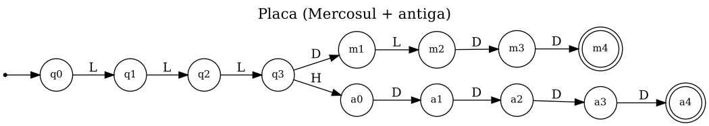
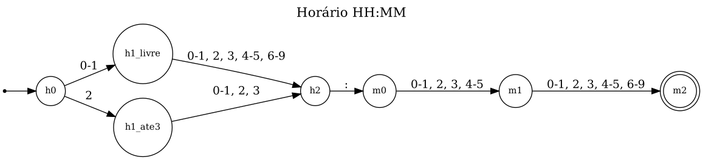
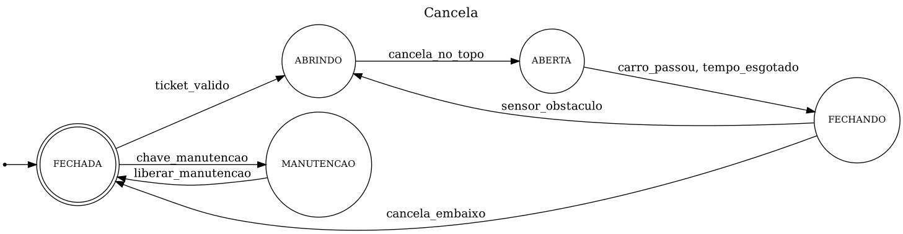
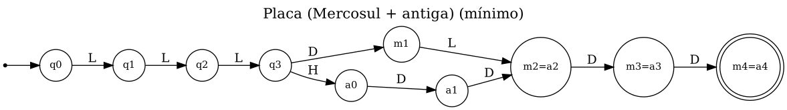

# 🅿️ Estacionamento Inteligente — Autômatos Finitos na Prática

**Projeto de Entrega · Prática 3 · Compiladores**
Ciência da Computação — 8º semestre · Prof. Hercules Ramos

## 👥 Integrantes

1. Lucas de Almeida Lima — RA 2421495
2. Yago Feitosa Kawauchi — RA 3227980
3. Isaías Inocêncio dos Santos — RA 2407953

---

## 1. Sobre o projeto

**Tema escolhido: Estacionamento inteligente** (um dos temas sugeridos no enunciado).

Para o mundo de um estacionamento com cancela automática construímos, só com Python puro, os três tipos de autômato vistos na aula:

| # | O que é | No nosso domínio | Onde ver |
|---|---|---|---|
| 1 | **Validadores** (AFD) | placa de veículo (Mercosul **e** antiga no mesmo AFD) e horário `HH:MM` | [seção 2](#2-validadores-afd--r1) |
| 2 | **Máquina de estados de negócio** | a **cancela**: `FECHADA → ABRINDO → ABERTA → FECHANDO`, com `sensor_obstaculo` reabrindo | [seção 5](#5-máquina-de-estados-de-negócio-a-cancela--r4) |
| 3 | **Mini-scanner** | linguagem de comandos do operador (`ENTRADA BRA2E19 08:15 VAGA A12`, `SAIDA ... PAGO 12.00`) | [seção 6](#6-mini-scanner-da-linguagem-do-estacionamento--r5) |

Todo autômato é escrito do mesmo jeito: **um dicionário** `delta = {(estado, símbolo): próximo_estado}`; se a chave não existe, não há seta no desenho e o autômato vai para o estado morto.

### Estrutura do repositório

```
.
├── README.md                                   ← este arquivo
├── Pratica3_Estacionamento_Inteligente.ipynb   ← notebook com TODO o código (já executado, com as saídas)
├── requirements.txt                            ← só o ipywidgets (para o painel)
└── docs/                                       ← desenhos gerados com Graphviz (.png) e o código DOT (.dot)
```

### Como rodar

**Opção 1 — Google Colab (recomendada)**
1. Abra o notebook `Pratica3_Estacionamento_Inteligente.ipynb` no Colab (*Arquivo → Fazer upload*, ou abra direto pelo GitHub).
2. Clique em **Ambiente de execução → Executar tudo**. Não é preciso instalar nada.

**Opção 2 — VS Code / Jupyter local**
```bash
pip install -r requirements.txt
jupyter notebook Pratica3_Estacionamento_Inteligente.ipynb      # ou abra o .ipynb no VS Code (kernel Python 3)
```
O desenho automático (bônus) usa o programa **Graphviz** (`dot`). Se ele não estiver instalado, o notebook **não quebra**: apenas imprime o código DOT, que pode ser colado em <https://dreampuf.github.io/GraphvizOnline>.
Para instalar: `sudo apt install graphviz` (Linux), `brew install graphviz` (macOS) ou o instalador de <https://graphviz.org/download/> (Windows, marcando a opção de adicionar ao PATH).

### Decisões de domínio (regras que adotamos)

- **Placa Mercosul:** `LLL D L DD` (ex.: `BRA2E19`). **Placa antiga:** `LLL-DDDD` (ex.: `ABC-1234`), **com hífen obrigatório** — `ABC1234` é rejeitada. Só letras **maiúsculas ASCII** (`A–Z`).
- **Horário:** formato 24 h, de `00:00` a `23:59`, sempre com dois dígitos em cada parte (`7:30` é rejeitado).
- **Cobrança (usada só na parte "tudo conectado"):** por **hora iniciada** × tarifa.
- Os formatos são simplificados para a disciplina, como o enunciado permite.

---

## 2. Validadores (AFD) — R1

O "motor" é a classe `AFD` do notebook: **M = (Q, Σ, δ, q0, F)**. Ele é escrito uma vez; cada problema só troca a tabela δ. Os caracteres são agrupados em **classes** para não desenhar uma seta por letra e por dígito.

### 2.1 Validador de placa (Mercosul + antiga) — 13 estados

| Caractere | Classe |
|---|---|
| `A` até `Z` | `L` (letra) |
| `0` até `9` | `D` (dígito) |
| `-` | `H` (hífen) |
| qualquer outro | `outro` (não tem seta → estado morto) |

**Desenho** (círculo duplo = estado de aceitação). Os 3 primeiros estados são comuns; em `q3` o autômato se divide:

```
 prefixo comum:   ──► (q0) ─L─► (q1) ─L─► (q2) ─L─► (q3)

 ramo Mercosul:   (q3) ─D─► (m1) ─L─► (m2) ─D─► (m3) ─D─► ((m4))

 ramo antigo:     (q3) ─H─► (a0) ─D─► (a1) ─D─► (a2) ─D─► (a3) ─D─► ((a4))
```



**Definição e `tabela()`:**

```text
Q = ['q0', 'q1', 'q2', 'q3', 'm1', 'm2', 'm3', 'm4', 'a0', 'a1', 'a2', 'a3', 'a4']   (13 estados)
Σ = ['D', 'H', 'L']
q0 = 'q0'   F = ['a4', 'm4']
```

```text
📋 Tabela de transição — Placa (Mercosul + antiga)
     estado    D   H   L
  →  q0        —   —  q1
     q1        —   —  q2
     q2        —   —  q3
     q3       m1  a0   —
     m1        —   —  m2
     m2       m3   —   —
     m3       m4   —   —
   * m4        —   —   —
     a0       a1   —   —
     a1       a2   —   —
     a2       a3   —   —
     a3       a4   —   —
   * a4        —   —   —
   (→ = inicial, * = aceitação, — = vai para o estado morto)
```

### 2.2 Validador de horário `HH:MM` — 7 estados, classes **finas**

Aqui a classe "dígito" não basta: se a hora começa com `2`, o segundo dígito só vai até `3`; e o primeiro dígito do minuto só vai até `5`. Por isso os dígitos são divididos em classes mais finas:

| Classe | Caracteres |
|---|---|
| `0-1` | `0`, `1` |
| `2` | `2` |
| `3` | `3` |
| `4-5` | `4`, `5` |
| `6-9` | `6`, `7`, `8`, `9` |
| `:` | `:` |
| `outro` | qualquer outro (sem seta → estado morto) |

**Desenho:**

```
                0-1                 qualquer dígito
         ┌──────────────► (h1_livre) ────────────────┐
         │                                           ▼          :           0-5           qualquer
 ──► (h0)┤                                          (h2) ──────────► (m0) ─────────► (m1) ─────────────► ((m2))
         │                                           ▲
         └──────────────► (h1_ate3) ─────────────────┘
                2                   0-1, 2, 3
```



> **Por que dois estados `h1_livre` e `h1_ate3`?** Porque o autômato precisa *lembrar* se a hora começou com `2`. Como ele não tem variáveis, a única forma de lembrar é **estar em um estado diferente**. *Estado = memória.*

**Definição e `tabela()`:**

```text
Q = ['h0', 'h1_livre', 'h1_ate3', 'h2', 'm0', 'm1', 'm2']   (7 estados)
Σ = ['0-1', '2', '3', '4-5', '6-9', ':']
q0 = 'h0'   F = ['m2']
```

```text
📋 Tabela de transição — Horário HH:MM
     estado          0-1         2         3       4-5       6-9         :
  →  h0         h1_livre   h1_ate3         —         —         —         —
     h1_livre         h2        h2        h2        h2        h2         —
     h1_ate3          h2        h2        h2         —         —         —
     h2                —         —         —         —         —        m0
     m0               m1        m1        m1        m1         —         —
     m1               m2        m2        m2        m2        m2         —
   * m2                —         —         —         —         —         —
   (→ = inicial, * = aceitação, — = vai para o estado morto)
```

---

## 3. Rastreamento passo a passo — R2

`rodar(palavra)` mostra, para cada caractere, **qual foi lido, a sua classe e de que estado para qual** o autômato foi.

### Placa

```text
🔎 Placa (Mercosul + antiga) lendo 'ABC-1234'
   passo lido   classe  de   para
   1     'A'    L       q0   q1
   2     'B'    L       q1   q2
   3     'C'    L       q2   q3
   4     '-'    H       q3   a0
   5     '1'    D       a0   a1
   6     '2'    D       a1   a2
   7     '3'    D       a2   a3
   8     '4'    D       a3   a4
   ✅ ACEITA: terminou em a4, que é de aceitação

🔎 Placa (Mercosul + antiga) lendo 'BRA2E19'
   passo lido   classe  de   para
   1     'B'    L       q0   q1
   2     'R'    L       q1   q2
   3     'A'    L       q2   q3
   4     '2'    D       q3   m1
   5     'E'    L       m1   m2
   6     '1'    D       m2   m3
   7     '9'    D       m3   m4
   ✅ ACEITA: terminou em m4, que é de aceitação

🔎 Placa (Mercosul + antiga) lendo 'BRA2019'
   passo lido   classe  de   para
   1     'B'    L       q0   q1
   2     'R'    L       q1   q2
   3     'A'    L       q2   q3
   4     '2'    D       q3   m1
   5     '0'    D       m1   💀 morto
   ❌ REJEITADA: não há transição de m1 com a classe 'D'

🔎 Placa (Mercosul + antiga) lendo 'ABC-123'
   passo lido   classe  de   para
   1     'A'    L       q0   q1
   2     'B'    L       q1   q2
   3     'C'    L       q2   q3
   4     '-'    H       q3   a0
   5     '1'    D       a0   a1
   6     '2'    D       a1   a2
   7     '3'    D       a2   a3
   ❌ REJEITADA: terminou em a3, que NÃO é de aceitação
```

- ✅ `ABC-1234` e `BRA2E19` são **aceitas**: cada uma percorre um ramo diferente depois de `q3` e termina em um estado de aceitação (`a4` / `m4`).
- ❌ `BRA2019` é **rejeitada porque o autômato morre no meio**: depois de `BRA2` ele está em `m1`, que só aceita uma **letra** (`L`); o `0` é um dígito (`D`), e não existe a seta `(m1, D)`.
- ❌ `ABC-123` é **rejeitada porque termina fora de F**: ele não morre — lê tudo até `a3` —, mas `a3` ainda espera o último dígito e **não é estado de aceitação**.

### Horário

```text
🔎 Horário HH:MM lendo '23:59'
   passo lido   classe  de         para
   1     '2'    2       h0         h1_ate3
   2     '3'    3       h1_ate3    h2
   3     ':'    :       h2         m0
   4     '5'    4-5     m0         m1
   5     '9'    6-9     m1         m2
   ✅ ACEITA: terminou em m2, que é de aceitação

🔎 Horário HH:MM lendo '24:00'
   passo lido   classe  de         para
   1     '2'    2       h0         h1_ate3
   2     '4'    4-5     h1_ate3    💀 morto
   ❌ REJEITADA: não há transição de h1_ate3 com a classe '4-5'

🔎 Horário HH:MM lendo '07:5'
   passo lido   classe  de         para
   1     '0'    0-1     h0         h1_livre
   2     '7'    6-9     h1_livre   h2
   3     ':'    :       h2         m0
   4     '5'    4-5     m0         m1
   ❌ REJEITADA: terminou em m1, que NÃO é de aceitação
```

- ✅ `23:59` é **aceita** e termina em `m2`.
- ❌ `24:00` **morre no meio**: depois do `2` o autômato está em `h1_ate3`, que só aceita as classes `0-1`, `2` e `3`; o `4` é da classe `4-5` e não tem seta.
- ❌ `07:5` **termina fora de F**: lê tudo, mas para em `m1` (falta o último dígito do minuto) e `m1` não é de aceitação.

---

## 4. Bateria de testes AFD × RegEx — R3

Para cada AFD existe uma **RegEx equivalente**. Rodamos as mesmas palavras nos dois e conferimos se concordam. Usamos `re.fullmatch` (e **não** `re.search`), porque o autômato exige que o texto **inteiro** case.

| Padrão | Expressão regular |
|---|---|
| Placa (Mercosul + antiga) | `[A-Z]{3}(?:[0-9][A-Z][0-9]{2}\|-[0-9]{4})` |
| Horário | `(?:[01][0-9]\|2[0-3]):[0-5][0-9]` |

Cada bateria tem **mais de 5 aceitas e mais de 5 rejeitadas, incluindo a palavra vazia `''`** — o caso que muita gente esquece e onde os bugs se escondem. Também incluímos casos de borda: `'BRA2E19\n'` (quebra de linha no fim), `'BRÀ2E19'` (letra acentuada), `' ABC-1234'` (espaço) etc.

### Placa

```text
palavra        AFD    RegEx 
'BRA2E19'      True   True   ✅
'ABC1D23'      True   True   ✅
'XYZ9A00'      True   True   ✅
'AAA0A00'      True   True   ✅
'ABC-1234'     True   True   ✅
'QWE-0000'     True   True   ✅
'ZZZ-9999'     True   True   ✅
''             False  False  ✅
'ABC1234'      False  False  ✅
'ABC-123'      False  False  ✅
'ABC-12345'    False  False  ✅
'AB1C234'      False  False  ✅
'abc1d23'      False  False  ✅
'BRA2E1'       False  False  ✅
'BRA2E199'     False  False  ✅
'ABC--1234'    False  False  ✅
'BRA2E19\n'    False  False  ✅
'BRÀ2E19'      False  False  ✅
' ABC-1234'    False  False  ✅
→ aceitas: 7 · rejeitadas: 12 · divergências: 0

🔬 Placa — verificação exaustiva: 87.381 palavras testadas, 0 divergências
```

### Horário

```text
palavra        AFD    RegEx 
'00:00'        True   True   ✅
'09:30'        True   True   ✅
'19:45'        True   True   ✅
'23:59'        True   True   ✅
'12:00'        True   True   ✅
'07:07'        True   True   ✅
'20:15'        True   True   ✅
''             False  False  ✅
'24:00'        False  False  ✅
'29:10'        False  False  ✅
'12:60'        False  False  ✅
'7:30'         False  False  ✅
'1:00'         False  False  ✅
'12h30'        False  False  ✅
'10:7'         False  False  ✅
'23:5'         False  False  ✅
'23:599'       False  False  ✅
'::'           False  False  ✅
'2400'         False  False  ✅
'12:3a'        False  False  ✅
→ aceitas: 7 · rejeitadas: 13 · divergências: 0

🔬 Horário — verificação exaustiva: 137.257 palavras testadas, 0 divergências
```

Além da bateria "manual", o notebook confere **todas** as palavras de até 8 (placa) e 6 (horário) símbolos sobre um alfabeto representativo: **0 divergências** nos dois casos.

---

## 5. Máquina de estados de negócio: a cancela — R4

Aqui os símbolos não são caracteres: são **eventos**. São **5 estados** e **8 transições**.

```
ciclo principal (os dois FECHADA são o mesmo estado):

 ──► (( FECHADA )) ──ticket_valido──► ( ABRINDO ) ──cancela_no_topo──► ( ABERTA )
                                           ▲                               │
                                           │  sensor_obstaculo             │  carro_passou
                                           │                               │  ou tempo_esgotado
                                           │                               ▼
 (( FECHADA )) ◄────cancela_embaixo──( FECHANDO ) ◄────────────────────────┘

manutenção (a partir do repouso):

 (( FECHADA )) ──chave_manutencao──► ( MANUTENCAO ) ──liberar_manutencao──► (( FECHADA ))
```



**Regras de negócio escondidas no desenho:**
- só se pode passar (`carro_passou`) com a cancela **aberta**;
- se o sensor detecta um obstáculo enquanto a cancela **fecha**, ela **reabre** (`FECHANDO → ABRINDO`);
- com a cancela aberta **não** dá para entrar em manutenção (não existe a seta `ABERTA --chave_manutencao-->`).

`FECHADA` é o estado de repouso (aceitação): um fluxo "completo" é o que termina com a cancela de volta em `FECHADA`.

```text
Q (5 estados) = ['FECHADA', 'ABRINDO', 'MANUTENCAO', 'ABERTA', 'FECHANDO']
δ (8 transições):
   FECHADA    --ticket_valido--> ABRINDO
   FECHADA    --chave_manutencao--> MANUTENCAO
   ABRINDO    --cancela_no_topo--> ABERTA
   ABERTA     --carro_passou--> FECHANDO
   ABERTA     --tempo_esgotado--> FECHANDO
   FECHANDO   --cancela_embaixo--> FECHADA
   FECHANDO   --sensor_obstaculo--> ABRINDO
   MANUTENCAO --liberar_manutencao--> FECHADA
```

**3 fluxos válidos e 2 inválidos.** Quando um evento é recusado, o código lista os **eventos permitidos** naquele estado (como numa mensagem de erro útil de compilador):

```text
=== FLUXOS VÁLIDOS ===

🚧 1) ciclo normal · eventos: ['ticket_valido', 'cancela_no_topo', 'carro_passou', 'cancela_embaixo']
   FECHADA     --ticket_valido--> ABRINDO
   ABRINDO     --cancela_no_topo--> ABERTA
   ABERTA      --carro_passou--> FECHANDO
   FECHANDO    --cancela_embaixo--> FECHADA
   ✅ fluxo completo: cancela de volta em FECHADA (repouso)

🚧 2) obstáculo reabre a cancela · eventos: ['ticket_valido', 'cancela_no_topo', 'carro_passou', 'sensor_obstaculo', 'cancela_no_topo', 'tempo_esgotado', 'cancela_embaixo']
   FECHADA     --ticket_valido--> ABRINDO
   ABRINDO     --cancela_no_topo--> ABERTA
   ABERTA      --carro_passou--> FECHANDO
   FECHANDO    --sensor_obstaculo--> ABRINDO
   ABRINDO     --cancela_no_topo--> ABERTA
   ABERTA      --tempo_esgotado--> FECHANDO
   FECHANDO    --cancela_embaixo--> FECHADA
   ✅ fluxo completo: cancela de volta em FECHADA (repouso)

🚧 3) manutenção · eventos: ['chave_manutencao', 'liberar_manutencao']
   FECHADA     --chave_manutencao--> MANUTENCAO
   MANUTENCAO  --liberar_manutencao--> FECHADA
   ✅ fluxo completo: cancela de volta em FECHADA (repouso)

=== FLUXOS INVÁLIDOS ===

🚧 4) passar com a cancela fechada · eventos: ['carro_passou']
   ❌ evento 1 'carro_passou' não é permitido em FECHADA. Permitidos: ['ticket_valido', 'chave_manutencao']

🚧 5) manutenção com a cancela aberta · eventos: ['ticket_valido', 'cancela_no_topo', 'chave_manutencao']
   FECHADA     --ticket_valido--> ABRINDO
   ABRINDO     --cancela_no_topo--> ABERTA
   ❌ evento 3 'chave_manutencao' não é permitido em ABERTA. Permitidos: ['carro_passou', 'tempo_esgotado']
```

---

## 6. Mini-scanner da linguagem do estacionamento — R5

O operador escreve um "roteiro" de comandos; o scanner (feito à mão — **cada laço `while` é um estado do autômato**) transforma o texto em tokens.

```
# exemplo de roteiro
TARIFA = 4.00
ALERTA LOTACAO >= 50
ENTRADA BRA2E19 08:15 VAGA A12
SAIDA BRA2E19 10:40 PAGO 12.00
```

### Tabela de tokens (12 tipos)

| Token | Padrão | Exemplos |
|---|---|---|
| `RESERVADA` | `ENTRADA` · `SAIDA` · `VAGA` · `PAGO` · `TARIFA` · `ALERTA` · `OBSTACULO` (7 palavras) | `ENTRADA` |
| `ID` | letra ou `_`, seguida de letras, dígitos ou `_` | `A12`, `LOTACAO` |
| `PLACA` | Mercosul `LLLDLDD` **ou** antiga `LLL-DDDD` | `BRA2E19`, `ABC-1234` |
| `HORA` | `DD:DD` (a faixa 00–23 / 00–59 é conferida pelo AFD de horário) | `08:15` |
| `NUM_INT` | um ou mais dígitos | `50` |
| `NUM_REAL` | dígitos, ponto, dígitos | `12.00` |
| `ATRIB` | `=` | `TARIFA = 4.00` |
| `IGUAL` | `==` | `LOTACAO == 100` |
| `MENOR` · `MENOR_IGUAL` | `<` · `<=` | |
| `MAIOR` · `MAIOR_IGUAL` | `>` · `>=` | `LOTACAO >= 50` |
| *(ignorados)* | espaços, tabs, quebras de linha e comentários `# ...` | |

### Casos de Maximal Munch

O scanner sempre lê o **maior** lexema possível:

| Entrada | Tokens | Por quê |
|---|---|---|
| `==` | `IGUAL` (e não `ATRIB` `ATRIB`) | lookahead de 1 caractere |
| `<=`, `>=` | `MENOR_IGUAL`, `MAIOR_IGUAL` | idem |
| `12.50` | `NUM_REAL` (e não `12` `.` `50`) | o ponto só entra se vier dígito depois |
| `08:15` | `HORA` (e não `08` `:` `15`) | exatamente 2 dígitos, `:` e 2 dígitos |
| `ABC-1234` | `PLACA` (e não `ABC` `-` `1234`) | lookahead: 3 maiúsculas seguidas de `-DDDD` |

### Palavras reservadas e placas

Primeiro lemos o lexema como se fosse um `ID`; **depois** conferimos se ele está na lista de reservadas (→ `RESERVADA`) ou se tem a forma de uma placa Mercosul (→ `PLACA`). As reservadas são **sensíveis a maiúsculas**: `entrada` é só um `ID`.

### Erros léxicos com linha, coluna e dica (o scanner continua depois do erro)

| Caractere | Dica específica do domínio |
|---|---|
| `,` | use ponto como separador decimal (ex.: `12.50`) |
| `:` | horário é `HH:MM`, com 2 dígitos de cada lado (ex.: `08:15`) |
| `-` | o hífen só existe na placa antiga: 3 letras maiúsculas + `-` + 4 dígitos (`ABC-1234`) |
| `.` | número real precisa de dígitos dos dois lados do ponto (ex.: `12.50`) |
| qualquer outro | caractere fora da linguagem do estacionamento |

### Exemplo de saída

O programa abaixo tem 3 erros léxicos de propósito (`8:55`, `4,00` e `@`). Repare que `4,00` virou **dois** números (`4` e `00`) e que o scanner **não parou** no primeiro erro:

```text
TIPO         LEXEMA     LIN COL
RESERVADA    TARIFA       2   1
ATRIB        =            2   8
NUM_REAL     4.00         2  10
RESERVADA    ALERTA       3   1
ID           LOTACAO      3   8
MAIOR_IGUAL  >=           3  16
NUM_INT      50           3  19
RESERVADA    ENTRADA      4   1
PLACA        BRA2E19      4   9
HORA         08:15        4  17
RESERVADA    VAGA         4  23
ID           A12          4  28
RESERVADA    ENTRADA      5   1
PLACA        ABC-1234     5   9
HORA         08:20        5  18
RESERVADA    VAGA         5  24
ID           B7           5  29
RESERVADA    SAIDA        6   1
PLACA        BRA2E19      6   7
HORA         10:40        6  15
RESERVADA    PAGO         6  21
NUM_REAL     12.00        6  26
RESERVADA    SAIDA        7   1
PLACA        ABC-1234     7   7
NUM_INT      8            7  16
NUM_INT      55           7  18
RESERVADA    PAGO         7  21
NUM_INT      4            7  26
NUM_INT      00           7  28
RESERVADA    ALERTA       8   1
ID           LOTACAO      8   8
IGUAL        ==           8  16
NUM_INT      100          8  19

⚠️ Linha 7, coluna 17: caractere inesperado ':' (horário é HH:MM, com 2 dígitos de cada lado (ex.: 08:15))
⚠️ Linha 7, coluna 27: caractere inesperado ',' (use ponto como separador decimal (ex.: 12.50))
⚠️ Linha 8, coluna 23: caractere inesperado '@' (caractere fora da linguagem do estacionamento)
```

Casos de borda (Maximal Munch, lookahead e dicas):

```text
'= == < <= > >='           → ATRIB(=) IGUAL(==) MENOR(<) MENOR_IGUAL(<=) MAIOR(>) MAIOR_IGUAL(>=)
                             (Maximal Munch: '=' vs '==', '<' vs '<=', '>' vs '>=')

'12 12.50 08:15'           → NUM_INT(12) NUM_REAL(12.50) HORA(08:15)
                             (Maximal Munch: inteiro, real e hora)

'ABC-1234 ABC1D23 ABC'     → PLACA(ABC-1234) PLACA(ABC1D23) ID(ABC)
                             (Maximal Munch + lookahead: placa antiga, placa Mercosul, ID)

'ENTRADA entrada VAGA'     → RESERVADA(ENTRADA) ID(entrada) RESERVADA(VAGA)
                             (palavras reservadas (maiúsculas) × ID)

'ABC- 1234'                → ID(ABC) NUM_INT(1234)
                             (hífen solto)
                             ⚠️ linha 1, coluna 4: '-' → o hífen só existe na placa antiga: 3 letras maiúsculas + '-' + 4 dígitos (ABC-1234)

'12. 3,5 8:15'             → NUM_INT(12) NUM_INT(3) NUM_INT(5) NUM_INT(8) NUM_INT(15)
                             (ponto sem dígito, vírgula decimal, hora com 1 dígito)
                             ⚠️ linha 1, coluna 3: '.' → número real precisa de dígitos dos dois lados do ponto (ex.: 12.50)
                             ⚠️ linha 1, coluna 6: ',' → use ponto como separador decimal (ex.: 12.50)
                             ⚠️ linha 1, coluna 10: ':' → horário é HH:MM, com 2 dígitos de cada lado (ex.: 08:15)
```

---

## 7. Interface — R6

A **Célula 8** do notebook monta um painel (`ipywidgets`) com 3 abas:

| Aba | O que faz |
|---|---|
| **Validadores** | escolha *Placa* ou *Horário*, digite uma palavra e clique em **Rodar**: aparece o passo a passo do AFD **e** a conferência com a RegEx |
| **Scanner** | cole um roteiro e clique em **Escanear**: aparecem a tabela de tokens e os erros com linha, coluna e dica |
| **Cancela** | digite eventos separados por espaço (ex.: `ticket_valido cancela_no_topo carro_passou cancela_embaixo`) e veja o fluxo |

Se aparecer só texto no lugar do painel, rode `pip install ipywidgets` (no Colab já vem instalado).

---

## 8. Bônus

### 8.1 AFD mínimo

Algoritmo de **refinamento de partições**: começa separando os estados de aceitação dos demais e vai separando os estados cujas transições levam a grupos diferentes, até nada mais mudar. O método `AFD.minimizar()` devolve o AFD mínimo.

- **Horário:** 7 estados → 7. **Nenhum estado equivalente**: o AFD já é mínimo.
- **Placa:** 13 estados → 10. Os estados `m2≡a2`, `m3≡a3` e `m4≡a4` são equivalentes (têm exatamente a mesma linguagem restante: `DD`, `D` e vazio), então os dois ramos podem **compartilhar o final**.

Os dois AFDs mínimos também foram conferidos contra a RegEx em todas as palavras da verificação exaustiva (0 divergências).

```text
🔬 Placa (Mercosul + antiga): 13 estados → 10 no AFD mínimo (partição por rodada: [3, 4, 6, 8, 9, 10, 11, 11])
   estados equivalentes: ['m2', 'a2']  (mesma linguagem restante)
   estados equivalentes: ['m3', 'a3']  (mesma linguagem restante)
   estados equivalentes: ['m4', 'a4']  (mesma linguagem restante)
   o AFD mínimo concorda com a RegEx em 87.381 palavras: 0 divergências

🔬 Horário HH:MM: 7 estados → 7 no AFD mínimo (partição por rodada: [3, 4, 5, 7, 8, 8])
   ✅ NENHUM estado equivalente: o AFD já é mínimo (cada par de estados se distingue por alguma palavra)
   o AFD mínimo concorda com a RegEx em 137.257 palavras: 0 divergências

📋 Tabela de transição — Placa (Mercosul + antiga) (mínimo)
     estado       D      H      L
  →  q0           —      —     q1
     q1           —      —     q2
     q2           —      —     q3
     q3          m1     a0      —
     m1           —      —  m2=a2
     m2=a2    m3=a3      —      —
     m3=a3    m4=a4      —      —
   * m4=a4        —      —      —
     a0          a1      —      —
     a1       m2=a2      —      —
   (→ = inicial, * = aceitação, — = vai para o estado morto)
```



### 8.2 Desenho automático com Graphviz

`AFD.para_dot()` gera o código DOT **a partir do próprio `delta`**, e a função `desenhar()` chama o `dot`. Todas as imagens da pasta `docs/` (`placa.png`, `placa_minimo.png`, `hora.png`, `cancela.png`) foram geradas assim, e os `.dot` estão ao lado.

### 8.3 Scanner por tabela

O mesmo scanner reescrito **sem nenhum `while` por estado**: um único `delta` combinado (31 estados, 75 transições, 14 classes de caractere) e o laço do Maximal Munch (anda na tabela, guarda o último estado de aceitação e volta para o fim do maior lexema aceito). Para garantir que os dois scanners são equivalentes, o notebook roda um **teste diferencial** com 5.000 programas aleatórios e também confere que o scanner e o validador de placa concordam:

```text
Scanner por tabela: 31 estados, 75 transições, 14 classes de caractere.
Roteiro da Célula 7: scanner com while == scanner por tabela? True
Teste diferencial (5.000 programas aleatórios): 0 divergências
Validador de placa × scanner (todas as palavras de até 8 símbolos): 0 conflitos
```

### 8.4 Tudo conectado

O scanner lê um **roteiro** em texto, os tokens são agrupados por linha em comandos, os **validadores AFD** conferem placa e horário e os comandos viram **eventos da máquina de estados da cancela** (`ENTRADA`/`SAIDA` disparam `ticket_valido → cancela_no_topo → carro_passou → cancela_embaixo`; `OBSTACULO` dispara `sensor_obstaculo`). Há também controle de lotação (`ALERTA`), tarifa (`TARIFA`) e cobrança por hora iniciada.

```text
📜 Scanner: 39 tokens e 1 erro(s) léxico(s)
   ⚠️ linha 10, coluna 28: ',' (use ponto como separador decimal (ex.: 12.50))

▶ linha 2: TARIFA = 4.00
   💲 tarifa = 4.00 por hora
▶ linha 3: ALERTA LOTACAO >= 50
   🔔 alerta registrado: LOTACAO >= 50
▶ linha 4: ENTRADA BRA2E19 08:15 VAGA A12
      🚧 cancela: FECHADA → ABRINDO → ABERTA → FECHANDO → FECHADA
   ✅ entrada de BRA2E19 às 08:15 na vaga A12 (lotação 25%)
▶ linha 5: ENTRADA ABC-1234 08:20 VAGA B7
      🚧 cancela: FECHADA → ABRINDO → ABERTA → FECHANDO → FECHADA
   ✅ entrada de ABC-1234 às 08:20 na vaga B7 (lotação 50%)
      🚨 ALERTA: LOTACAO >= 50 (atual: 50%)
▶ linha 6: SAIDA BRA2E19 10:40 PAGO 12.00
      🚧 cancela: FECHADA → ABRINDO → ABERTA → FECHANDO → FECHADA
   ✅ saída de BRA2E19: 145 min = 3 h × 4.00 = 12.00 (pago 12.00)
▶ linha 7: ENTRADA XYZ9A00 25:99 VAGA C3
   ❌ hora inválida '25:99': o AFD de horário recusou (vai de 00:00 a 23:59)
▶ linha 8: SAIDA ABC-1234 09:00 PAGO 1.00
   ❌ pagamento insuficiente: 40 min = 1 h × 4.00 = 4.00, pago 1.00
▶ linha 9: OBSTACULO
      ❌ cancela: evento 'sensor_obstaculo' não é permitido em FECHADA. Permitidos: ['ticket_valido', 'chave_manutencao']
▶ linha 10: SAIDA ABC-1234 09:10 PAGO 4 00
   ❌ comando mal formado (sequência de tokens: SAIDA PLACA HORA PAGO NUM NUM)

📊 No fim do dia: dentro = ['ABC-1234'] · cancela = FECHADA
```

Repare no que cada linha demonstra: a linha 7 é recusada pelo **AFD de horário** (`25:99` tem a forma de uma hora, mas não é válida), a linha 9 mostra um evento recusado pela **cancela** (com os eventos permitidos) e a linha 10 mostra o scanner **continuando depois do erro** de vírgula, deixando o comando mal formado.

---

## 9. Requisitos × onde estão

| Requisito | Onde |
|---|---|
| **R1** Dois validadores (AFD), ≥ 5 estados, classes finas, desenho e `tabela()` | seção 2 · notebook células 2 e 3 |
| **R2** Rastreamento passo a passo (1 aceita + 1 rejeitada, com explicação) | seção 3 |
| **R3** Bateria AFD × RegEx (≥ 5 aceitas, ≥ 5 rejeitadas, palavra vazia, 0 divergências) | seção 4 · célula 4 |
| **R4** Máquina de estados (≥ 5 estados, ≥ 6 transições, eventos permitidos, 2 fluxos válidos e 2 inválidos) | seção 5 · célula 5 |
| **R5** Mini-scanner (≥ 8 tokens, ≥ 3 reservadas, Maximal Munch, erros com linha/coluna/dica, continua após o erro) | seção 6 · células 6 e 7 |
| **R6** Interface com `ipywidgets` para validadores **e** scanner | seção 7 · célula 8 |
| **R7** README | este arquivo |
| **Bônus** AFD mínimo · Graphviz · scanner por tabela · tudo conectado | seção 8 · células 9 a 12 |

O notebook termina com uma **autoavaliação** (célula 13) que confere os requisitos R1 a R6 por código, com `assert`.

---

## 10. Referências

- CARMO, Robson. *Compiladores*. São Paulo: Centro Universitário FMU, 2026. (Apostila da disciplina — Unidades 5 e 6.)
- AHO, Alfred V.; LAM, Monica S.; SETHI, Ravi; ULLMAN, Jeffrey D. *Compiladores: Princípios, Técnicas e Ferramentas*. 2. ed. São Paulo: Pearson Addison-Wesley, 2008. (Cap. 3 — Análise Léxica.)
- MENEZES, Paulo F. B. *Linguagens Formais e Autômatos*. 6. ed. Porto Alegre: Bookman, 2011.
- SIPSER, Michael. *Introdução à Teoria da Computação*. São Paulo: Cengage Learning, 2007. (Cap. 1 — Linguagens Regulares.)
- Documentação do módulo `re` do Python: <https://docs.python.org/3/library/re.html>
- Documentação do ipywidgets: <https://ipywidgets.readthedocs.io>
- Graphviz: <https://graphviz.org/documentation/>
